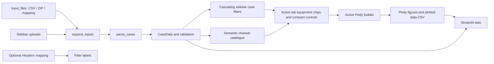

# Architecture

Parsing, filtering, channel discovery, validation and figure generation are ordinary Python modules and do not import Streamlit. `app.py` connects their outputs to widgets and chart tabs.

## Modules

- `data_loader.py` expands CSV and ZIP inputs in memory, parses two header rows, preserves source positions and numeric sequences, and reports malformed cases.
- `mapping.py` reads only the `Headers` sheet and maps positive token positions to display headings.
- `case_filters.py` supplies natural sorting, left-to-right token filtering and collision-safe case labels.
- `channel_catalogue.py` resolves exact metric descriptions and discovers WTG, loading, POC and power-factor objects.
- `plotting.py` builds the five chart families, applies explicit sign transforms, balances whole element×case bundles by plotted-point count, and exports plotted data.
- `equipment_pills.py` renders text-sized, wrapping equipment chips with single-click selection and Ctrl-click multi-selection.
- `validation.py` defines structured issues shared by the data and mapping layers.
- `app.py` scans sources, controls session-scoped caches, renders the sidebar upload and global checkbox filters, and shows active-tab controls only after cases load.

## Cache and state

Local file bytes and expanded/parsed results use session-scoped resource caches keyed by path/metadata and source path/origin/content SHA-256 tuples. Upload records are cached by upload ID, name and size. Each immutable `InputFile` memoises its SHA-256 value, avoiding another full-file hash on subsequent reruns. Cached source and parse objects are returned by reference rather than serialised and copied. The channel catalogue is cached by source signature; mapping results use the smaller data cache. Plot sets use a bounded per-session cache keyed by selected case content, labels, sources and chart settings, so unrelated reruns reuse figures; empty case selections skip chart construction. Local file changes produce a new metadata signature and reload automatically. Removing uploaded files from the sidebar uploader changes the upload signature and selects the corresponding cached source set.

Case filters, tab-specific equipment choices, layouts, references, axis source and sign choices live in Streamlit session state. Axes use shared data-derived ranges and panels are automatically balanced by plotted-point weight. Plot results use a bounded session cache with an explicit rendering revision in the cache key. The parser and Plotly builders receive plain data records and remain usable without Streamlit.
