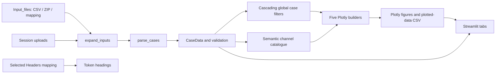

# Architecture

Parsing, filtering, channel discovery, validation and figure generation are ordinary Python modules and do not import Streamlit. `app.py` connects their outputs to widgets and chart tabs.

## Modules

- `data_loader.py` expands CSV and ZIP inputs in memory, parses two header rows, preserves source positions and numeric sequences, and reports malformed cases.
- `mapping.py` reads only the `Headers` sheet and maps positive token positions to display headings.
- `case_filters.py` supplies natural sorting, left-to-right token filtering and collision-safe case labels.
- `channel_catalogue.py` resolves exact metric descriptions and discovers WTG, loading, POC and power-factor objects.
- `plotting.py` builds the five chart families, applies explicit sign transforms, distributes whole element×case bundles, and exports plotted data.
- `validation.py` defines structured issues shared by the data and mapping layers.
- `app.py` scans sources, controls cache and session state, renders the filters and active chart tab, and presents validation details.

## Cache and state

Local file bytes are read through a cache keyed by relative path, file size and modification time. Expanded and parsed data are cached by source path/origin/content SHA-256 tuples; tab changes and chart controls reuse those results. Reload clears cached data and rescans local inputs. Uploads are keyed to the active uploader generation; clearing uploads remounts the uploader while preserving the rest of the session.

The selected case tokens, legend token positions, tab-specific elements, layouts, ranges, reference lines, axis source and sign choices live in Streamlit session state. The parser and Plotly builders receive plain data records and remain usable without Streamlit.
